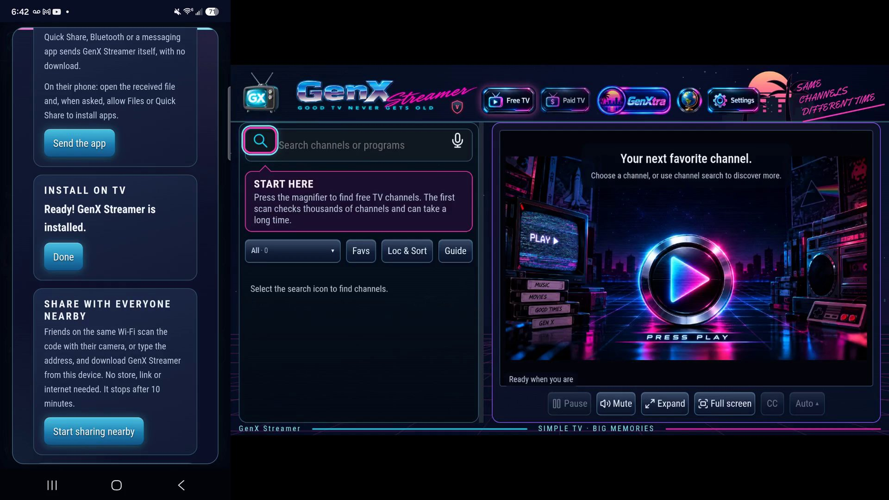
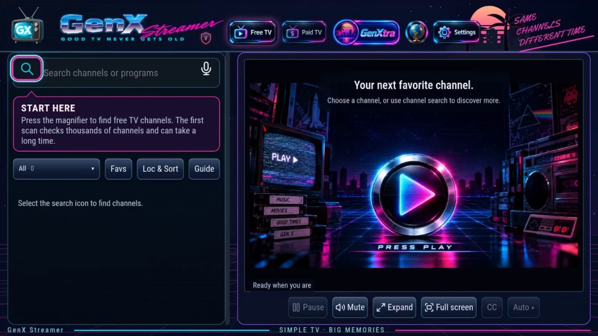
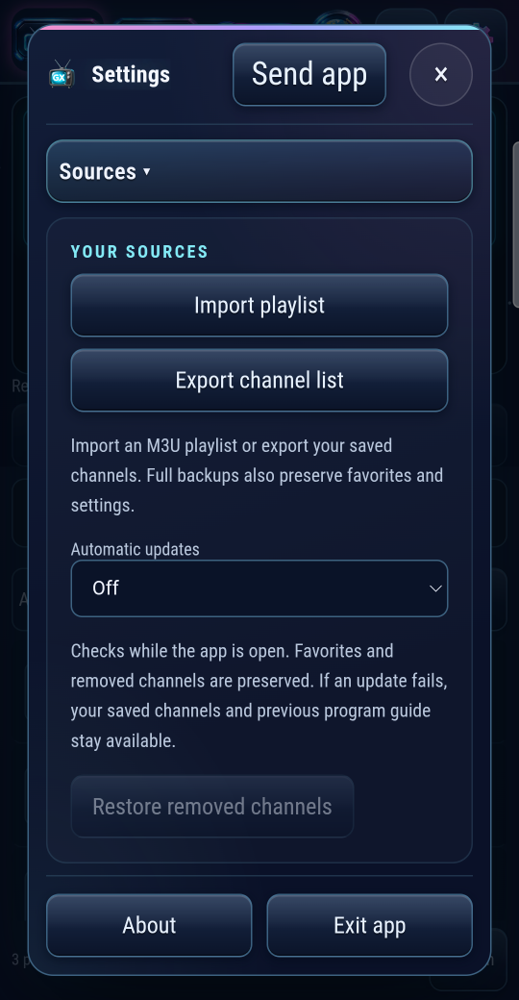
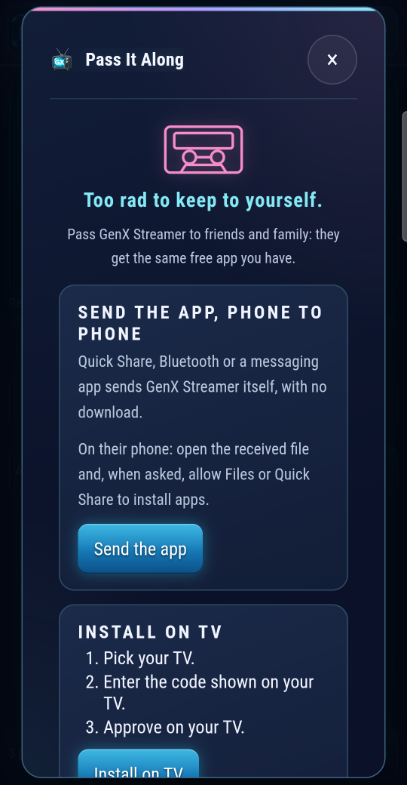
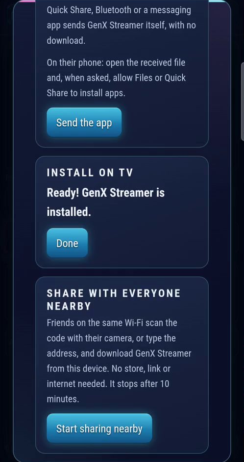
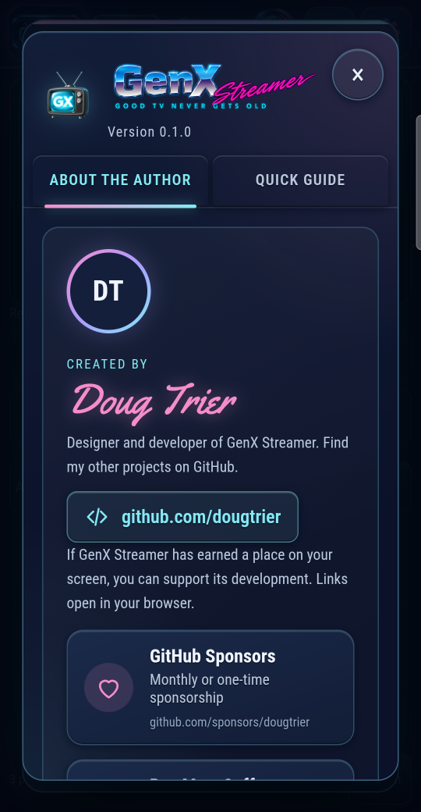

<div align="center">
  

  **Good TV never gets old.**

  Free live TV, a program guide and a public-domain film library for Windows,
  Android TVs, phones and handhelds. Pass it along to a friend with no app store.

  [](https://github.com/DougTrier/GenX-Streamer/releases)
  [](https://tauri.app/)
  [](https://www.rust-lang.org/)
  [](docs/user-guide.md)
  [](docs/user-guide.md)
  [](#-current-verified-state)
  [](LICENSE)

  [User guide](docs/user-guide.md) •
  [Pass It Along](docs/share-links.md) •
  [Install on TV](docs/send-to-tv.md) •
  [Updates](docs/updates.md) •
  [Verify a download](docs/verify-a-download.md) •
  [Architecture](ARCHITECTURE.md) •
  [Contributing](CONTRIBUTING.md)

  ---

  *If GenX Streamer earns a place on your screen, please star the repo. It helps keep it going.*
</div>

---

## ✅ Current Verified State

| Evidence | Result |
| --- | --- |
| **Version** | 0.1.0, development release |
| **Development gate** (`npm run verify`) | PASS: 3,310 unit tests, 579 interface tests, 1,503 Rust tests, 114 casting harness checks, 43 tooling tests, types, format, lint, privacy scan |
| **Windows** | Release build and packaged native smoke test PASS: every test stream format played, the guide opened beside playback, clean exit in 70 ms, saved data intact |
| **Android release** | Signed with the owner's release key (one universal APK, 32- and 64-bit ARM); installed and run on a Samsung Galaxy S25 |
| **Install on TV, on real TVs** | Verified first installs from the S25 on a Google TV Streamer (no browser, so the download helper route, including waking it from its screensaver) and a Sansui Google TV (browser route). The installed file matched the file sent, byte for byte |
| **Independent code review** | No critical or high findings; every medium and low finding fixed or documented ([details](docs/share-links.md#rules-for-passing-the-app-on-sh-009-to-sh-025)) |
| **Last verified** | October 24, 2026 |

---

## 👋 Start Here

> 1. **Want to watch?** → [Download the latest release](https://github.com/DougTrier/GenX-Streamer/releases/latest), then read the [User guide](docs/user-guide.md)
> 2. **Got it from a friend?** → [Check your copy is genuine](docs/verify-a-download.md)
> 3. **Want to pass it on?** → [Pass It Along](docs/share-links.md) and [Install on TV](docs/send-to-tv.md)
> 4. **Developer?** → [Architecture](ARCHITECTURE.md), [component guides](docs/components/README.md) and [Contributing](CONTRIBUTING.md)

---

## 🎬 Pass It Along: phone to TV, unedited

[](docs/media/pass-it-along-install-on-tv.mp4)

*An unedited recording ([watch, 2 min 33 s](docs/media/pass-it-along-install-on-tv.mp4)) of a Galaxy S25 and a Google TV Streamer side by side:*
1. The TV starts in its screensaver.
2. **Install on TV** on the phone wakes the TV and finds that it has no app to download with.
3. GenX opens the free download helper in the TV's Play Store.
4. GenX sends itself from the phone over Wi-Fi.
5. The TV owner approves each step with the TV remote.
6. The phone confirms **"Ready! GenX Streamer is installed."** only after GenX on the TV reports the very file it was sent.

No app store, no GitHub link, no typing on the TV.

---

## ⚡ What Makes GenX Different

| | Most TV apps | GenX Streamer |
| --- | --- | --- |
| Getting it | An app store account | A friend's phone or TV, a QR code, or a link |
| Installing on a TV | Store search, or sideloading by hand | **Install on TV**: pick the TV, enter its code, approve on the TV |
| Channels | A catalog chosen for you | Free channels found and health-checked on your device; your own playlists and accounts |
| Old TVs and handhelds | Often unsupported | 32-bit Android TVs, phones and handhelds; its own MPEG-2 and MPEG audio decoders where the device has none |
| Your data | In the cloud | On your device; no account, no tracking |
| Testing | Tested for success | Tested for failure: rules (invariants) with codes, real-device runs, recorded evidence |

---

## 📸 Screenshots

<div align="center">

**On a TV**



**On a phone**

| Settings | Pass It Along | Install on TV | About |
| --- | --- | --- | --- |
|  |  |  |  |

</div>

---

## 📺 Features

- **Free TV**: finds public channels, checks they actually play, and keeps the
  ones that do. Favourites, filters, search and voice search.
- **Paid TV**: your own provider accounts (Xtream), kept in your device's
  protected storage and played through a local relay.
- **GenXtra**: a public-domain film and TV library with downloads.
- **Program guide** (XMLTV), instant replay, captions, a remote and D-pad
  friendly interface on TVs, and casting to Chromecast and DLNA screens.
- **Pass It Along**:
  - send the app phone to phone (Quick Share, Bluetooth);
  - **share with everyone nearby** with a QR code or a short six-digit
    address, no internet needed;
  - **install on a Google TV or Android TV** from your phone;
  - send a download link.

  Every device gets the build that runs on it, or a plain "this won't run
  here". ([How it works](docs/share-links.md))
- **Voluntary updates**: Check for Updates in About, verified against the
  published SHA-256 before anything installs. ([Rules](docs/updates.md))

---

## 📦 Get GenX Streamer

Download from [Releases](https://github.com/DougTrier/GenX-Streamer/releases/latest):

| File | For |
| --- | --- |
| `GenX-Streamer-<version>-Android.apk` | Android TVs, phones, tablets and handhelds (ARM, 32- and 64-bit), Android 7.0 or newer |
| `GenX-Streamer-<version>-Windows-x64.exe` | Windows 10 and 11 (64-bit), with the Microsoft Edge WebView2 Runtime |
| `GenX-Streamer-<version>-Windows-x64-portable.zip` | Windows, portable: extract to a folder of its own and run `GenX Streamer.exe` |
| `SHA256SUMS` | Checksums to [verify any copy](docs/verify-a-download.md) |

The Android app is signed with the GenX Streamer release key. The Windows app
is unsigned by decision, so SmartScreen may show an unknown-publisher prompt
on first run.

---

## 🧭 Provenance

GenX Streamer includes two decoders of its own, for formats that some devices
offer apps no decoder for (for example Samsung Galaxy phones and MPEG-2 video):

- **Trier MPEG Video** decodes MPEG-2 video (Main Profile, 4:2:0). It was
  written from the published standard, ITU-T H.262 | ISO/IEC 13818-2. Its
  variable-length code tables are extracted from the text of the free ITU-T
  edition by `scripts/trier-video/extract_tables.py`, not retyped from other
  software. Design and measurements: [docs/trier-mpeg-video.md](docs/trier-mpeg-video.md).
- **Trier MPEG** decodes MPEG audio Layers I and II. It was written from
  ISO/IEC 11172-3 and the lower-sampling-frequency extension in ISO/IEC 13818-3.
  Design: [docs/trier-mpeg.md](docs/trier-mpeg.md).

Neither decoder contains code from FFmpeg, libmpeg2 or any other decoder, and
the Windows and Android apps do not include or link FFmpeg.

During development, FFmpeg (the `ffmpeg-static` development dependency) and
libmpeg2 serve only as outside measuring tools:
- FFmpeg encodes the test streams;
- both decode the same streams so Trier's pictures can be compared with an
  established decoder.

Trier's output is not bit-identical to FFmpeg's: in the recorded comparison it
matched exactly in 1 of 12 streams. That is expected of an independent
implementation, since MPEG-2 defines an accuracy bound for the inverse DCT, not
one exact result. Tests that need FFmpeg skip themselves when it is not
installed.

Other formats (H.264, HEVC, AAC and the rest) are decoded by the platform:
Android's Media3/MediaCodec and the system WebView.

---

## ⚙️ Build and Test

### Requirements

- Node.js 22 or newer, npm
- Rust (stable) with the `aarch64-linux-android` and `armv7-linux-androideabi`
  targets for Android builds
- Windows: Microsoft Edge WebView2 Runtime (the app does not install it)
- Android builds: Android SDK, NDK 28.2.13676358 and a JDK (Android Studio's
  `jbr` works). The build scripts use `ANDROID_HOME` if set.
- PowerShell 7.5 or newer (the build helpers and some tooling tests)
- Python 3.11 or newer for the license inventory tooling

### Build

```powershell
npm ci
pwsh -NoProfile -File scripts/build-windows.ps1 -Profile Release
pwsh -NoProfile -File src-tauri/scripts/build-android.ps1 -Architecture aarch64 -Optimization 2
```

- **Windows:** `scripts/build-windows.ps1` writes
  `src-tauri/target/release/GenX Streamer.exe`.
- **Android development builds:** `build-android.ps1` makes debug-signed APKs.
  Use `-Optimization 2` for anything installed on a device.
- **Signed Android releases:** `src-tauri/scripts/build-android-release.ps1`
  makes the one universal APK (arm64-v8a and armeabi-v7a), signed with the
  owner's key. It refuses a key kept inside the repository and checks the
  signer against the fingerprint compiled into the app.
  See [docs/release-signing.md](docs/release-signing.md).

### Test

`npm run verify` runs every development check in order:
- types, format and lint;
- unit and interface tests;
- the privacy scan;
- Rust format, lint and native tests;
- the casting harness;
- the tooling tests.

It writes a receipt under `artifacts/development-verification/`. Run it from
PowerShell 7. The checks one by one:

```powershell
npx vitest run                         # unit and browser-component tests
npx playwright test tests/ui           # interface tests
cd src-tauri; cargo test --lib         # native tests
node --test tests/tooling/*.test.mjs   # tooling tests
python -B -X utf8 -m unittest discover -s tests/tooling
```

Packaged acceptance runs (Windows, isolated data folders, owned fixtures):

```powershell
node scripts/native-smoke.mjs "src-tauri/target/release/GenX Streamer.exe"
node tests/native/playback-fault-matrix.mjs --exe=<absolute exe> --sha256=<sha256>
node tests/native/channel-switch-smoke.mjs <exe> 500 <sha256>
```

Device checks need an approved device in the environment:
`GENX_APPROVED_FLIP_SERIAL`, `GENX_APPROVED_TV_SERIAL`, and `ADB` for the adb
path. Without them the device scripts refuse to run.

### Release

Every release needs a **higher version**: Check for updates compares
versions, and Android refuses to update to an equal or lower one. The version
is written in several files; one command changes them all and checks they
agree:

```powershell
node scripts/bump-version.mjs patch    # 0.1.0 -> 0.1.1: fixes
node scripts/bump-version.mjs minor    # 0.1.0 -> 0.2.0: new features
node scripts/bump-version.mjs check    # do all files agree? (run by npm run verify)
```

Then build, package and publish:

1. Run `npm run verify`.
2. Build Windows with `build-windows.ps1 -Profile Release`, and the signed
   Android APK with `build-android-release.ps1`.
3. Make the notices and the package (below).
4. Publish a GitHub release tagged `v<version>` with the APK, the exe, the
   ZIP, `SHA256SUMS`, `release-manifest.json` and the Android notices.

```powershell
node scripts/release-notices.mjs --inventory <inventory.json> --crates <crate list> --product "GenX Streamer for Windows" --output <new file>
node scripts/package-candidate.mjs --windows-exe <exe> --output-dir <new folder> --windows-profile release --mode windows-only --notices <notices> --source-revision <commit>
pwsh -NoProfile -File scripts/windows-sandbox-launch-check.ps1 -Zip <zip> -Out <new folder>
```

The package holds the release files named with version and platform (above),
a `release-manifest.json` and `SHA256SUMS`. The version comes from
`src-tauri/tauri.conf.json` unless `--version` is given. The in-app updater
picks its file by these names from the latest GitHub release
([docs/updates.md](docs/updates.md)).

---

## 🔐 Privacy and Security

- No account, no analytics, no tracking. Channel lists, favourites, history
  and Paid TV accounts stay on your device; Paid TV credentials live in the
  operating system's protected storage.
- Shared links carry only a channel's name, logo and public stream address,
  never Paid TV details. Incoming links are treated as untrusted
  ([share-links.md](docs/share-links.md)).
- Nearby sharing:
  - answers only devices on your own network, with a fresh six-digit code
    each time;
  - locks out guessing and ends after ten minutes, on Stop, or when you leave
    the Wi-Fi.
- Install on TV:
  - pairs only with the code the TV shows;
  - opens only GenX's own links on the TV;
  - never approves anything for you: every install is your choice on the TV
    ([send-to-tv.md](docs/send-to-tv.md)).

Before publishing or copying this repository anywhere, run:

```powershell
node scripts/clean-repo.mjs scan
```

It blocks credentials, keys, databases, user-profile paths and private network
addresses. Your own device serials, addresses and paths belong in an untracked
`.private-patterns.json` (already in `.gitignore`); reviewed test placeholders
are listed by fingerprint in `scripts/clean-repo-allow.json`.

Design notes and rule registers are in [docs/](docs/). The rules carry codes
such as `SH-019` or `TV-006` in comments and tests: [docs/codes.md](docs/codes.md).
Requirements: [Engineering Spec.MD](Engineering%20Spec.MD). Open work:
[TASKS.md](TASKS.md).

---

## ❤️ Support the Project

GenX Streamer is free, with no ads and no subscriptions. If it has earned a
place on your screen:

- [GitHub Sponsors](https://github.com/sponsors/dougtrier)
- [Buy Me a Coffee](https://www.buymeacoffee.com/dougtrier)
- [Open Collective](https://opencollective.com/trier-os)

The same links are in the app, in **About GenX Streamer**.

---

## 🤝 Contributing

Developers are welcome. [CONTRIBUTING.md](CONTRIBUTING.md) explains how to set
up, make and check a change; [docs/components/](docs/components/README.md) has
a guide for each part of the app (playback, scans, the program guide, the Trier
decoders, the interface and more) so you can start with the one you know best.

---

## 📜 License

GenX Streamer's source code is licensed under the
[Apache License 2.0](LICENSE). Copyright 2026 Doug Trier. See [NOTICE](NOTICE)
for the third-party components and their licenses.

The GenX Streamer name, logo and brand artwork are not covered by the Apache
License: a fork you publish should use its own name and icons. See
[TRADEMARK.md](TRADEMARK.md).
