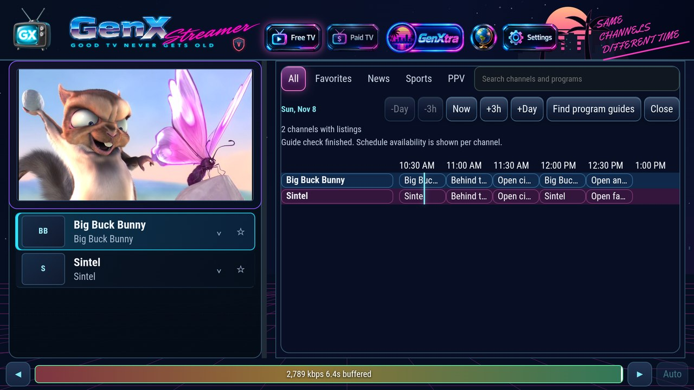
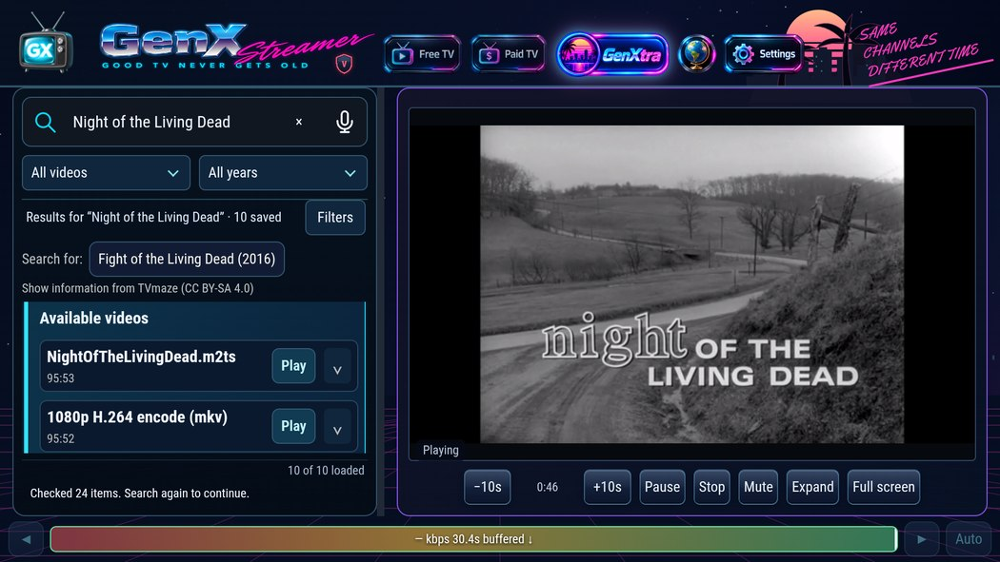
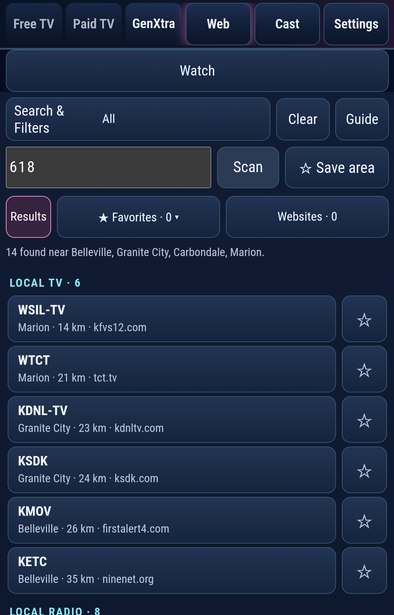
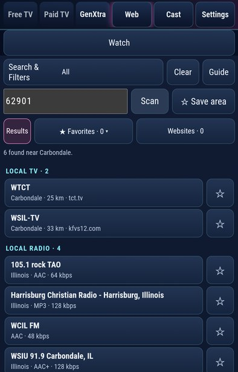
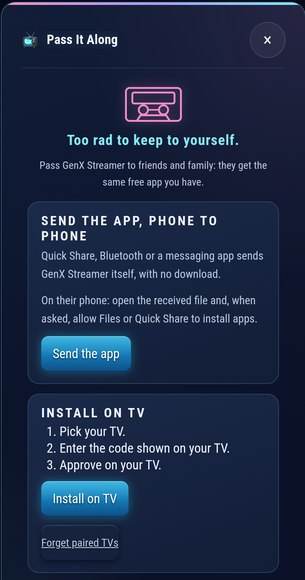
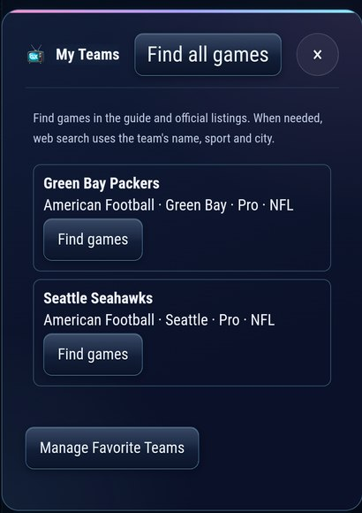
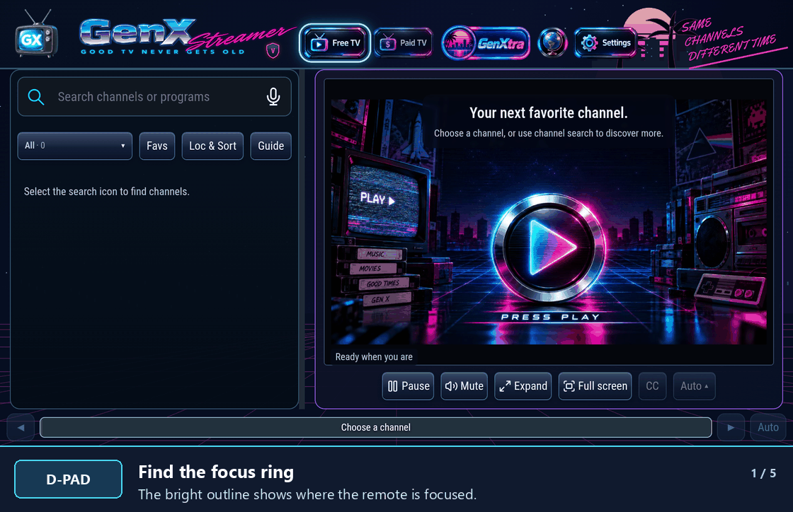
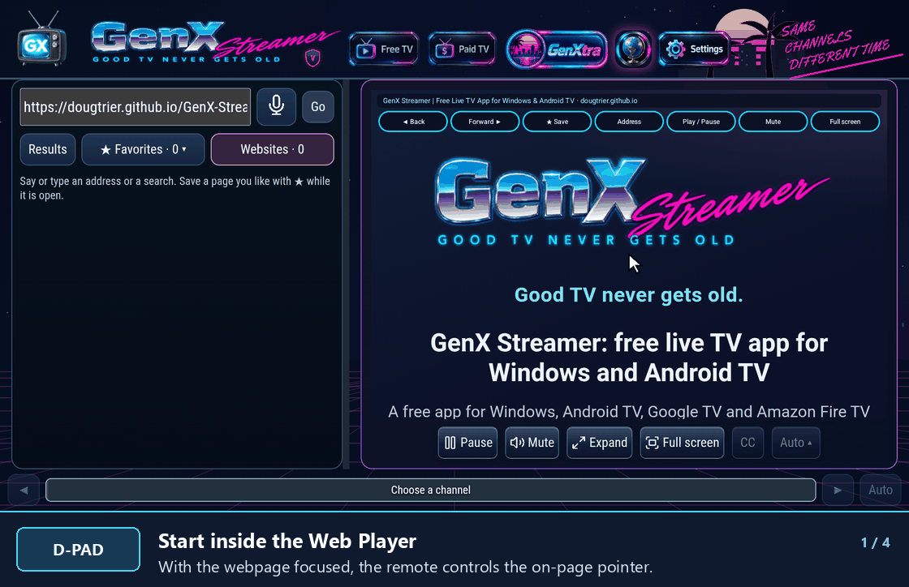

  
  <h1>Your TV. Your lineup.</h1>
  
Start with an empty lineup. Discover public channels, see what’s on, and save the ones you want.

  
<strong><a href="https://github.com/DougTrier/GenX-Streamer/releases/tag/v0.1.33">Download GenX Streamer 0.1.33</a></strong> · <a href="https://dougtrier.github.io/GenX-Streamer/getting-started/">Installation and setup</a> · <a href="https://dougtrier.github.io/GenX-Streamer/#commercial">Watch the commercial</a>

  
Free for Windows, compatible Android TVs, Android phones, and handhelds.

*Free TV and the Guide on Android TV. This demo uses a sample schedule and open films. Big Buck Bunny © 2008 Blender Foundation / www.bigbuckbunny.org, [CC BY 3.0](https://peach.blender.org/about/). Select the image to see it full size.*

## Discover, check, and save

GenX Streamer comes with **no preloaded channels or subscriptions**. GenX searches across publicly available sources it can reach. You can also add a playlist of your own. GenX checks which streams respond, and you decide what to save.

Publishers decide what they make available. GenX manages how the app handles those sources, keeps your lineup on your device, and uses protected device storage for any Paid TV provider credentials you add.

## What makes GenX different

- **Play more formats with GenX’s own Trier codecs.** On compatible Android devices, GenX can decode MPEG-2 video and MPEG Layer I or II audio when the device lacks the decoder the stream needs.
- **Pass It Along.** Share the app with someone nearby, or send it from your phone to a compatible Android TV or Google TV. Pick the TV, enter its code, and approve the install with the remote. Share Free TV favorites with another GenX device on the same network or export a favorites file. [Sharing guide](docs/share-links.md)
- **Find local stations from the Web Player.** Enter an area code to look near several cities, or use a ZIP to focus the search. Stream radio, open TV station websites inside GenX, and save places and stations you want to revisit.
- **Follow your teams.** Add favorites in My Teams and look for games in your guide and in official listings. Watch links appear when GenX can verify them.
- **Rediscover classic film and TV with GenXtra.** Search for public-domain titles and watch or download them from available sources.

*GenXtra on Android TV, playing the original 1968 black-and-white Night of the Living Dead.*

## See the phone and TV experiences

<strong>Local discovery on Android phone and TV</strong>

Area code <strong>618</strong> looks near several cities in southern Illinois. ZIP <strong>62901</strong> focuses on Carbondale. Results depend on the sources available at the time of the scan.

<table>
<thead><tr><th>Area code 618</th><th>ZIP 62901</th></tr></thead>
<tbody><tr><td></td><td></td></tr></tbody>
</table>

<a href="docs/screenshots/web-local-zip-62220.png">Belleville ZIP 62220</a> · <a href="docs/screenshots/web-local-radio-wsiu.png">WSIU selected in the player</a> · <a href="docs/screenshots/tv-web-local-area-618.png">618 on TV</a> · <a href="docs/screenshots/tv-web-local-zip-62901.png">62901 on TV</a> · <a href="docs/screenshots/tv-web-genx-site.png">Built-in browser on TV</a>

<strong>Pass It Along and My Teams on Android</strong>

<table>
<thead><tr><th>Pass It Along</th><th>My Teams</th></tr></thead>
<tbody><tr><td></td><td></td></tr></tbody>
</table>

<a href="docs/screenshots/my-teams-before.png">My Teams on a fresh phone install</a> · <a href="docs/screenshots/tv-my-teams-before.png">Empty list on TV</a> · <a href="docs/screenshots/tv-my-teams-after.png">Followed teams on TV</a> · <a href="docs/send-to-tv.md">Install on TV guide</a>

<strong>Android TV remote walkthroughs</strong>

<strong>Move with the D-pad.</strong> The bright ring follows focus. Press Right to move between tabs and OK to open the highlighted tab.

<strong>Switch the Web Player to full screen.</strong> With focus in the webpage, press Up twice quickly. Press Down twice quickly to return to the window.

## Get GenX Streamer

| Device | Download |
| --- | --- |
| Android TV, Google TV, Android-based Fire TV, Android phones, tablets, and handhelds | Android APK for 32-bit and 64-bit ARM devices running Android 7.0 or newer |
| Windows 10 or 11 with WebView2 | Windows x64 portable ZIP. Extract the full ZIP and open **GenX Streamer.exe**. |

## Content sources and rights

GenX Streamer starts with an empty channel lineup and includes no subscriptions. It searches publicly available sources it can reach, checks which streams respond, and lets you choose what to save. You can also add your own playlists or provider accounts.

Publishers and hosts control what they make publicly available. Users control the sources they add to their own devices. GenX is responsible for how the app handles those sources and protects user data.

Source availability changes over time. Discovery results reflect what GenX can reach when you search. A stream responding shows that it was reachable at the time of the check.

For requests to remove or restrict access to the underlying content, contact the publisher or hosting service directly.

[0.1.33 downloads](https://github.com/DougTrier/GenX-Streamer/releases/tag/v0.1.33) · [User guide](docs/user-guide.md) · [Verify a download](docs/verify-a-download.md) · [Apache License 2.0](LICENSE)
